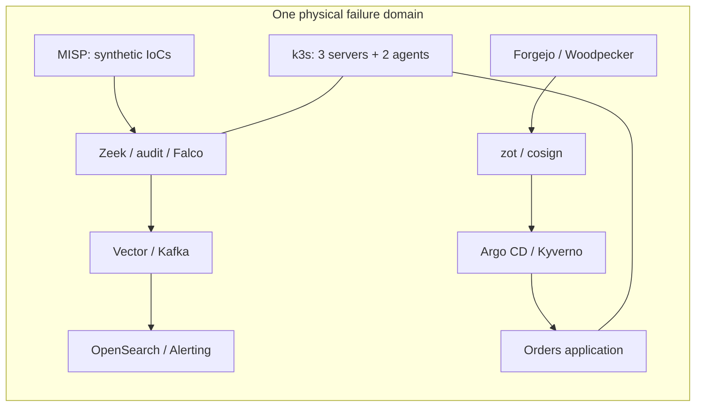

# K8S-LAB

A Kubernetes security lab connecting platform operations, security telemetry and signed software delivery.

**Personal learning project, not a production platform.** The original environment ran five Linux VMs: three k3s servers with embedded etcd and two agents. This repository preserves implementation and learning material, with a sanitized account of results recorded on **13 October 2026**. A deployment from a fresh clone has **not** been reproduced.

[Français](README.fr.md) · [Architecture](docs/architecture.md) · [Learning path / parcours](docs/learning-path.md) · [Evidence](docs/evidence-summary.md) · [Reproduction scope](docs/reproducibility.md)

## What this project demonstrates

| Engineering question | Implementation | Recorded result and boundary |
|---|---|---|
| Can a signal be traced to an alert? | Zeek and Kubernetes audit → Vector → Kafka → OpenSearch; Falco runtime events; MISP synthetic indicators | Original SOC acceptance: 16 of 17 synthetic detection cases produced fresh documents and persisted alerts. Later fixes improved the missing audit selector, without a complete 17-case replay. |
| Can controls prevent a deployment or connection? | Pod Security Admission, Kyverno, Cilium policies and RBAC | 12 hardening proofs and 57 permission checks passed within a defined application scope; privileged sensors remain exceptions. |
| Can the deployed image be tied to a build? | Forgejo → Woodpecker → Kaniko → Trivy → zot → cosign → Argo CD | A real push triggered a 92-second pipeline. Signed production admission succeeded; an unsigned image was rejected. Promotions used direct Git commits, not required PR approval. |
| Was anything actually restored? | Velero and Garage S3 | A small namespace/PVC drill restored an identical payload checksum. Full etcd restore and off-host disaster recovery were not tested. |
| What happened when the architecture failed? | Resource observations, recovery scripts and documented decisions | Memory/I/O contention, unsafe disk cache and host crashes led to corruption and loss of six log indices. Recovery did not restore their lost history. |

The [dated evidence summary](docs/evidence-summary.md) explains sources and reconciles older drafts. Raw private logs, credentials and infrastructure inventory are not included.

## System at a glance



These are logical paths, not a live health display. [Architecture and trust boundaries](docs/architecture.md) are documented in French.

## Review without deploying

Start with the [documentation map](docs/documentation-map.md), then inspect [application code](app/README.md), [delivery](devsecops/README.md), [hardening](hardening/README.md) and [SOC components](soc/README.md).

From the repository root, the pure application tests need only Python 3:

```sh
(cd app && python3 -m unittest discover -s tests -v)
```

This exercises input validation, not Kubernetes, PostgreSQL or Kafka. `make check` runs the package's offline syntax/unit checks and publication audit; `make test` is an alias for those local checks, **not** the original lab's live smoke test. The separately gated `make smoke` requires an operator-provisioned lab.

**Runtime boundary:** exercise/scenario runners and their cleanup helpers are disabled in this public snapshot pending safety repairs. They are retained as reference code, not ready-to-run automation; see [disabled paths and required repairs](tools/RUNTIME_DISABLED.md). Other runtime scripts require explicit operator consent and provisioning.

Do not treat a file named `test.sh` as harmless: phase acceptance can create workloads, emit traffic, pause consumers, save/delete snapshots or restart nodes. Read [reproduction scope](docs/reproducibility.md) before running any infrastructure command.

## Historical checkpoint

An independent read-only observation on **13 October 2026 at 22:58:23 CEST** recorded **40/40 smoke checks passing**, exit 0, in 3.61 seconds: five Ready nodes, four Synced/Healthy Argo applications, three Kafka brokers and a green three-node OpenSearch cluster. Seventeen registered Alerting monitors were enabled; 9,406 connection documents were found in the preceding ten minutes. This was not a replay of scenarios, builds or restores, and it does not guarantee future health or certificate renewal.

## Limits worth reading first

- All replicas shared one physical host and storage device; logical HA was not physical HA.
- The CI scan excludes unfixed CRITICAL findings. A later bounded production-image scan found **2 CRITICAL and 10 HIGH** findings.
- SOC ingress includes HTTP; identity, secrets, trust custody and threat-intelligence revocation have lab-only compromises.
- Clean-clone provisioning, off-host recovery, sustained performance and RPO/RTO remain unverified.

See [limitations](docs/limitations.md) and the [safe five-minute demo](docs/demo.md).

## Author and publication

Project by **Alexis Fructus**. Repository: `hades-x/k8s-security-lab`. This public reference snapshot is separate from the private running lab.

The owner chose **no project license for now**. This is not an MIT-licensed or otherwise open-source-licensed release. Third-party notices remain separate; final privacy and provenance review still apply. Historical Woodpecker results are not a public GitHub Actions run.
