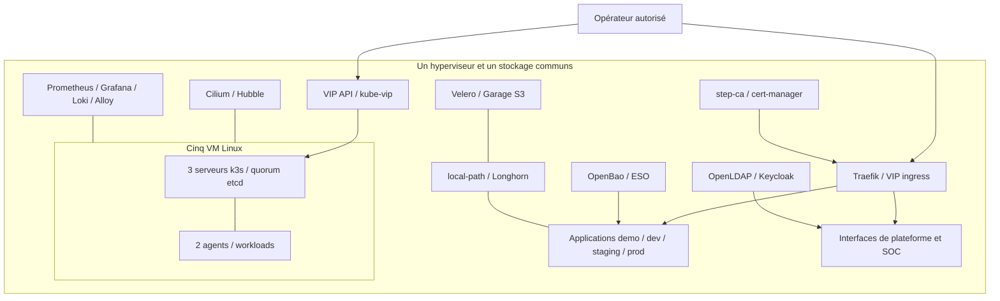
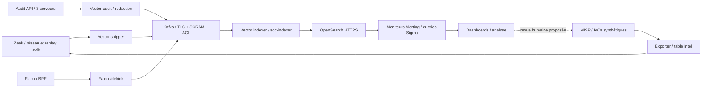
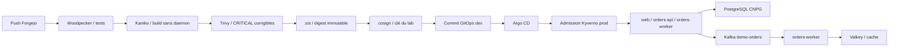

# Architecture et frontières de confiance

[Accueil](../README.fr.md) · [Preuves datées](evidence-summary.md) · [Limites](limitations.md)

Cette architecture décrit le lab documenté le **13 octobre 2026**, pas son état présent. Les configurations conservées et les résultats historiques sont deux objets différents. Les anciens snapshots d'après-midi sont réconciliés dans le bilan : signature prod acceptée plus tard, réplicas OpenSearch rétablis à un, Kafka rétabli au contrôle indépendant du soir.

## Vue globale

Les boîtes représentent des fonctions ; elles ne sont pas des zones réseau indépendantes. Le contrôle de quorum et la réplication entre VM ne protègent pas contre la perte de l'hôte ou du stockage partagé. Les invités du lab sont Linux ; aucune migration d'annuaire Windows, aucun service cloud ni broker d'accès équivalent à Teleport n'est démontré.

## Topologie de référence

| Élément | Exemple isolé du lab | Interprétation |
|---|---|---|
| Réseau VM | `192.168.150.0/24`, NAT libvirt | Ne pas réutiliser sans vérifier les collisions et l'interface de sortie |
| Passerelle | `192.168.150.1` | L'hôte reste joignable depuis les VM ; ce n'est pas un air gap |
| API | `192.168.150.10:6443` | VIP kube-vip, distincte de l'ingress |
| Serveurs | `.11`, `.12`, `.13` | API et etcd embarqué ; également des workloads dans ce lab |
| Agents | `.21`, `.22` | Exécution applicative et capteurs |
| LoadBalancer | `.200` à `.239` | Cilium LB-IPAM et annonces L2 ; ingress `.200` |
| Pods / Services | `10.42.0.0/16` / `10.43.0.0/16` | Adresses internes de ce plan d'exemple |

Ces CIDR sont conservés parce que les manifests et garde-fous en dépendent. Ils ne désignent pas une infrastructure publique. Les noms `<service>.192.168.150.200.sslip.io` des configurations résolvent une IP privée : cette résolution ne fournit ni route cliente, ni confiance TLS, ni exposition Internet.

Après la remédiation mémoire, les cinq invités avaient chacun 10 Gio et 6 vCPU configurés, soit 50 Gio de RAM invitée et 30 vCPU. Les caps qcow2 étaient de 40 Gio par serveur et 60 Gio par agent. Ce sont des allocations/caps, pas une consommation mesurée ni un dimensionnement recommandé. Le budget initial de 44 Gio était devenu obsolète. Les réservations kubelet ont été observées sur un serveur ; l'exercice ressources a confirmé leur absence sur les agents.

Cilium utilise le routage natif et remplace kube-proxy ; Flannel est désactivé. Traefik fournit les routes Ingress. La présence des CRD Gateway API ne prouve pas une migration complète vers Gateway API.

## Chaîne SOC

Le retour analyste → MISP reste conceptuel, pas une automatisation déployée. Hubble observe les communications et verdicts Cilium ; il ne remplace ni les événements protocole Zeek ni l'audit des acteurs API.

Les sept topics SOC sont `zeek-conn`, `zeek-dns`, `zeek-http`, `zeek-notice`, `zeek-intel`, `audit-k8s`, `falco-alerts`. Le contrat est trois partitions, RF3 et minISR2, avec rétention 24 h et cap de 256 Mi **par partition**. `demo-orders` est un topic applicatif distinct à une partition. Les brokers KRaft combinent rôle contrôleur et broker.

Vector retire les corps de Secrets dans les événements d'audit, normalise les champs Zeek et filtre les lectures système routinières après l'incident mémoire. L'indexer ne marque les offsets comme livrés qu'après succès du sink. Le contrat reste **at-least-once**, avec doublons et pertes historiques possibles. Un drain à lag zéro pendant une pause contrôlée ne mesure pas la capacité sous charge continue.

La détection active repose sur 17 moniteurs query-level Alerting. Une règle supplémentaire de scénario porte sur un Secret GET refusé ; ne pas confondre nombre de fichiers de règles et nombre de moniteurs de base. La création d'un détecteur natif a ensuite réussi via un alias sans point, mais ce détecteur de preuve est resté désactivé. Son exécution et son rollover ne sont pas validés.

## Livraison et application

La promotion staging/prod réutilise le digest par commits Git séparés. Le contrôle de signature porte sur les images prod ; une signature prouve le lien au signer attendu, pas l'absence de vulnérabilités. Le gate CI exclut les CRITICAL sans correctif. Les preuves positives et négatives d'admission sont historiques.

Le chemin métier est POST → PostgreSQL → Kafka → worker → Valkey → GET. Les bases sont mono-instance, le cache n'est pas un stockage durable, l'API HTTP n'est pas authentifiée et il n'y a pas d'outbox transactionnelle. Une erreur de publication Kafka après commit SQL peut laisser une commande persistée sans événement livré.

## Contrôles et périmètres

| Contrôle | Portée démontrée | Frontière restante |
|---|---|---|
| PSS restricted / Kyverno | Namespaces applicatifs et fixtures ciblées | Capteurs, stockage et services système ont des exemptions |
| Default-deny / allowlists | `demo`, `dev`, `staging`, `prod` | Pas de default-deny universel SOC/infra |
| Quarantaine Cilium | Refus ingress/egress, y compris DNS | Le droit administratif `exec` via API n'est pas coupé |
| RBAC | Matrice de 57 attentes viewer/dev/analyst | Créer un workload peut donner un accès indirect aux Secrets |
| PKI | Racine jetable, intermédiaire step-ca, ACME | Racine stockée sur l'hôte en ligne ; fallback CA étend l'exposition de clé |
| OpenBao / ESO | Raft mono-nœud, sync d'un secret de démonstration | Unseal manuel 1/1 ; transports et disponibilité limités |
| Keycloak / LDAP | Sessions SSO applicatives testées | LDAP interne en clair, Keycloak dev ; OIDC kubectl non validé |
| Velero / Garage | Petit restore PVC avec checksum égal | Destination locale, pas PRA hors hôte ou restore etcd |

Les principaux espaces sont `kube-system`, `longhorn-system`, `argocd`, `forgejo`, `cert-manager`, `pki`, `identity`, `secrets`, `monitoring`, `s3`, `velero`, `kafka`, `opensearch`, `soc-sensors`, `misp`, `falco`, `ci`, `cnpg-system`, puis les environnements applicatifs. Un namespace organise les ressources ; sa seule existence ne crée pas l'isolation.

Les fichiers `VERSIONS`, valeurs Helm et digests de chaque composant sont les références du package. Ils fixent un état du projet, pas les versions « latest » ni une recommandation de sécurité actuelle. Avant toute installation, revoir compatibilité, provenance et trust roots selon le [périmètre de reproduction](reproducibility.md).
